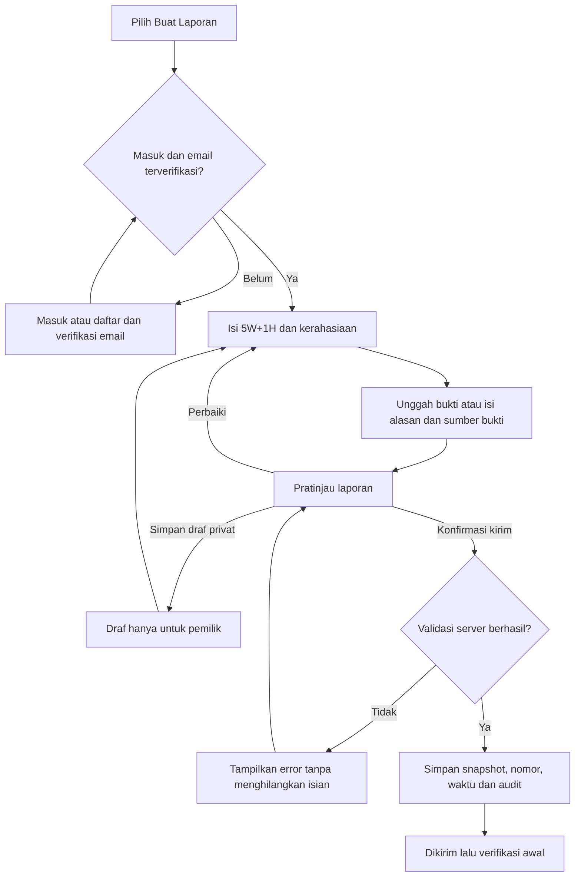
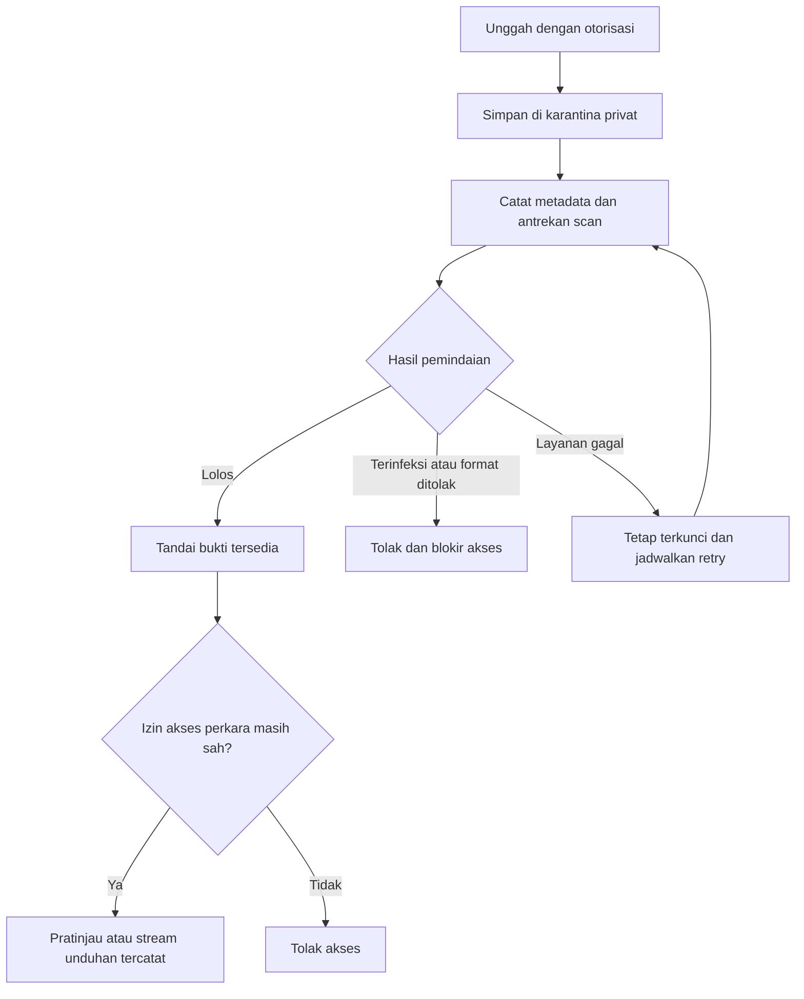
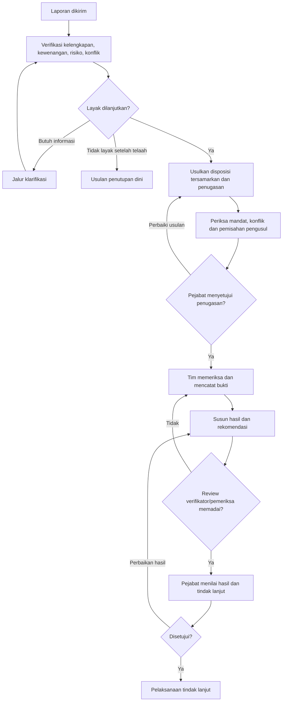
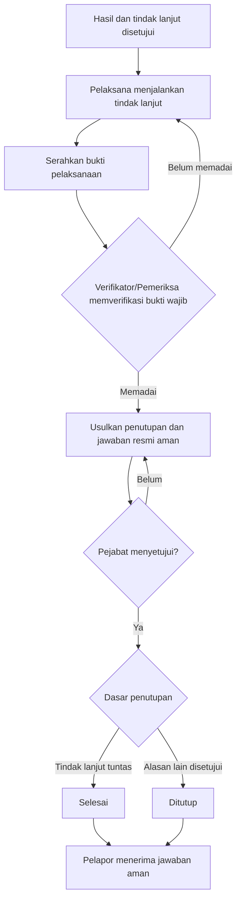
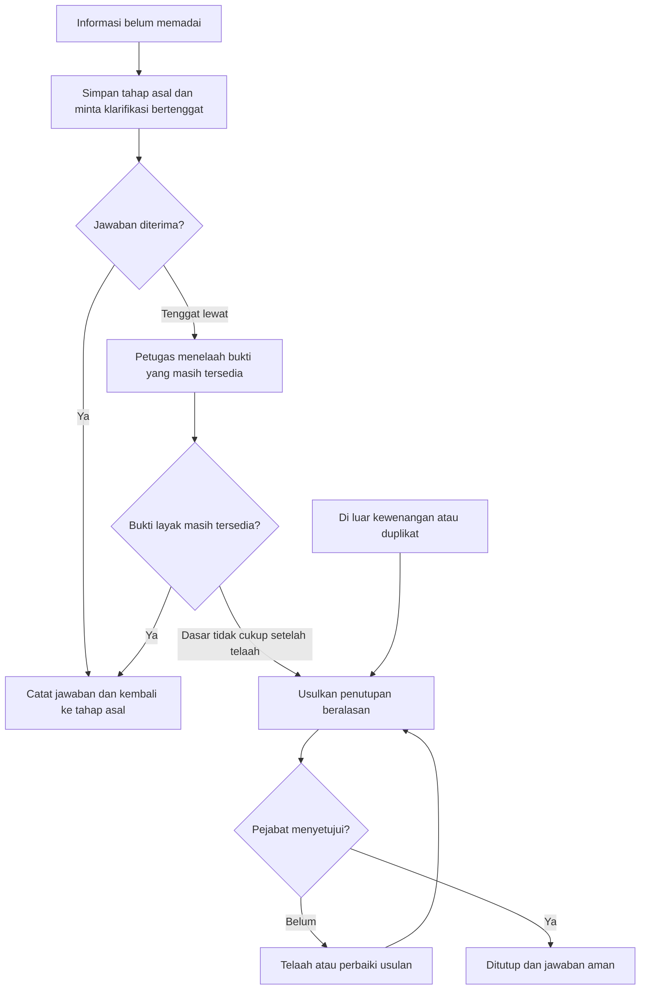
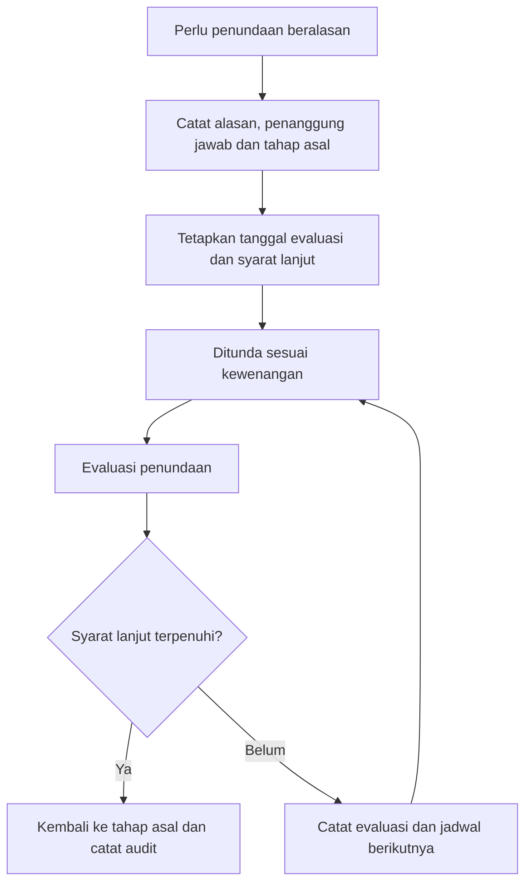
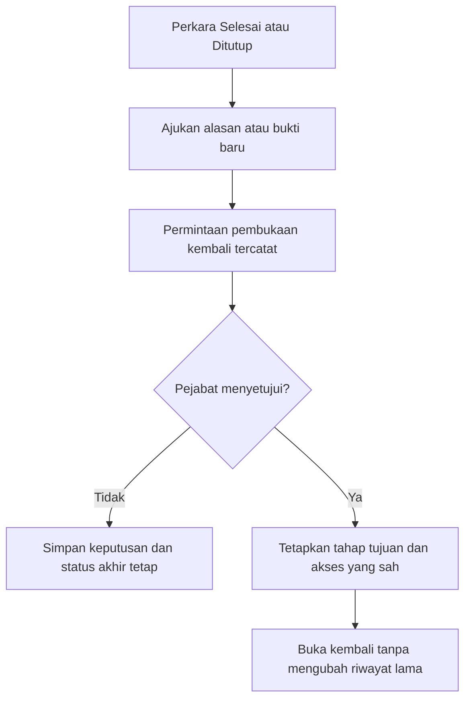
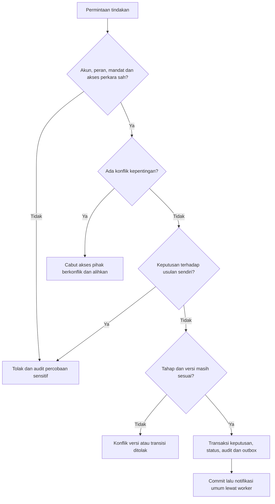
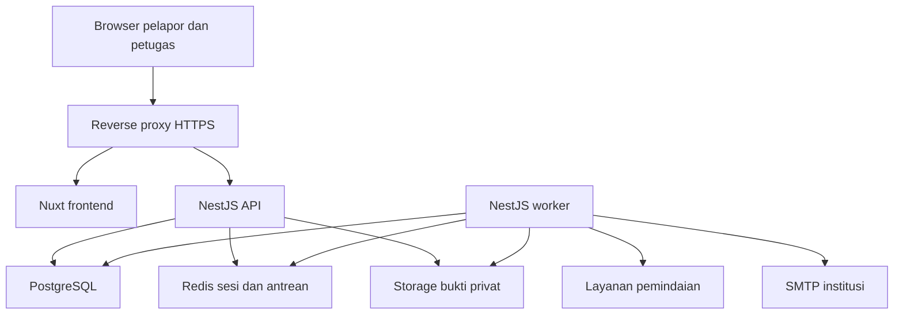

# Flowchart — WBS Universitas Jember

Draf 0.1 • Pendamping PRD • Berdasarkan SOP draf 0.1 tanggal 5 November 2026.
Diagram Mermaid dapat dirender pada viewer Markdown yang mendukung Mermaid. Label status teknis merupakan usulan, sedangkan kendali mengikuti SOP. Diagram dibagi agar jalur koreksi terbaca.

## 1. Akun dan pengiriman — sumber halaman 1

## 2. Siklus bukti — sumber halaman 1, rincian worker usulan teknis

Pemindaian tidak otomatis menjadi syarat penerbitan tanda terima. Lampiran pending tetap tidak dapat diakses; status scan diperlihatkan terpisah.

## 3. Verifikasi sampai hasil — sumber halaman 2

Jalur perbaikan hasil setelah penilaian pejabat adalah detail implementasi usulan agar revisi tetap tercatat; mandat dan tahapan revisi final perlu ditetapkan.

## 4. Tindak lanjut dan penutupan — sumber halaman 3

## 5. Klarifikasi dan penutupan dini — sumber halaman 3

Tidak ada penutupan otomatis karena pelapor diam. Detail perlakuan jawaban terlambat harus ditetapkan dalam kebijakan.

## 6. Penundaan — sumber halaman 3

Pihak berwenang menetapkan perubahan evaluasi; perpanjangan bukan aksi otomatis worker.

## 7. Pembukaan kembali — sumber halaman 3

## 8. Gerbang setiap keputusan — penjabaran teknis kendali SOP

## 9. Arsitektur aplikasi — usulan

Nuxt memanggil `/api/v1` pada origin yang sama. Reverse proxy meneruskan jalur API ke NestJS. Storage dan database tidak diekspos langsung ke browser.
