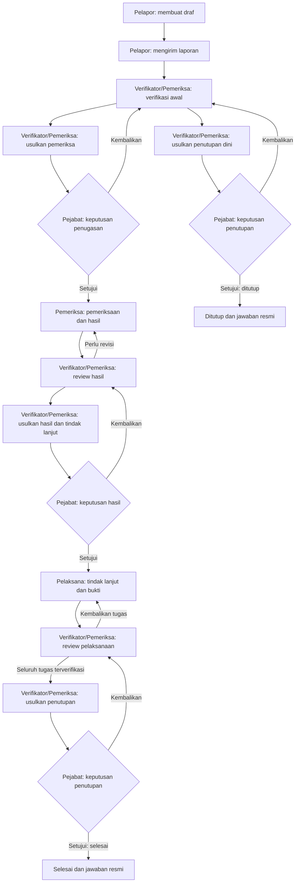

# Role dan alur pelaporan WBS Universitas Jember

Dokumen ini menjelaskan perilaku yang sudah diterapkan pada kode per 12 November 2026. Tujuannya sebagai panduan pengguna dan simulasi UAT lintas role. Fitur yang masih direncanakan dipisahkan pada bagian batas implementasi.

## 1. Role dan tanggung jawab

| Role sistem | Nama pengguna | Tanggung jawab | Syarat akses perkara |
| --- | --- | --- | --- |
| `REPORTER` | Pelapor | Membuat dan mengedit draf, mengirim laporan, menjawab klarifikasi, memantau status, membaca jawaban resmi, serta meminta pembukaan kembali | Hanya laporan miliknya sendiri |
| `INVESTIGATOR` | Verifikator/Pemeriksa | Menerima dan memverifikasi laporan, meminta klarifikasi, mengusulkan penugasan, memeriksa sesuai penugasan aktif, menelaah hasil, mengusulkan tindak lanjut, memverifikasi pelaksanaan, serta mengusulkan penutupan/pembukaan kembali | Memiliki akses perkara aktif; penerima laporan baru harus anggota intake aktif; penyerahan hasil pemeriksaan memerlukan penugasan aktif yang disetujui pejabat |
| `OFFICIAL` | Pejabat berwenang | Menyetujui atau mengembalikan usulan penugasan, hasil/tindak lanjut, penutupan, dan pembukaan kembali | Memiliki akses perkara dan mandat aktif sesuai jenis keputusan |
| `EXECUTOR` | Pelaksana tindak lanjut | Menjalankan instruksi, mengunggah bukti, serta menyerahkan catatan pelaksanaan | Akses diberikan setelah persetujuan hasil/tindak lanjut; hanya dapat menyerahkan tugas miliknya |
| `SUPER_ADMIN` | Super admin | CRUD kategori laporan; pengaturan logo, nama aplikasi/institusi, tagline, dan kontak bantuan; melihat audit administrasi | Tidak mendapat akses isi perkara; akun dibuat melalui `db:seed:admin`, terpisah dari lima akun demo |

Ada empat role operasional: Pelapor, Verifikator/Pemeriksa, Pejabat berwenang, dan Pelaksana tindak lanjut. Administrasi hanya menggunakan Super Admin. Role Pengelola lama (`MANAGER`) digabung ke `INVESTIGATOR` melalui migrasi database tanpa menghapus akun, penugasan, akses, atau riwayat perkara.

Registrasi publik menghasilkan akun pelapor. Pengguna tidak memilih role internal melalui formulir registrasi. Role internal saja tidak otomatis membuka seluruh laporan: sistem memeriksa akses per perkara, konflik kepentingan, serta syarat tindakan.

### Akun demo dari seed

| Email | Role |
| --- | --- |
| `pelapor@example.test` | Pelapor |
| `pengelola@example.test` | Verifikator/Pemeriksa |
| `pejabat@example.test` | Pejabat berwenang |
| `pemeriksa@example.test` | Verifikator/Pemeriksa (petugas kedua) |
| `pelaksana@example.test` | Pelaksana tindak lanjut |

Password mengikuti `SEED_PASSWORD` saat menjalankan `npm.cmd run db:seed`, minimal 12 karakter. Seed membuat akun demo terverifikasi, mendaftarkan verifikator/pemeriksa demo sebagai anggota intake, dan memberi pejabat demo mandat 30 hari untuk `ASSIGNMENT`, `RESULT`, `CLOSURE`, dan `REOPEN`. Super Admin dibuat secara terpisah melalui `db:seed:admin`; seed demo tidak membuat akun Super Admin dan tidak mengganti password akun yang sudah ada. Jika persetujuan ditolak karena mandat kedaluwarsa, periksa mandat; seed dapat membuat mandat demo baru ketika tidak ada mandat aktif untuk jenis keputusan tersebut.

## 2. Gambaran alur utama

Diagram menunjukkan jalur utama. Klarifikasi, penundaan, konflik, dan pembukaan kembali dijelaskan pada bagian 5.

## 3. Langkah pelaporan sampai selesai

### Langkah 1 — Pelapor membuat draf

Pelapor mendaftar atau masuk, lalu membuat laporan. Akun yang belum terverifikasi dapat menyimpan draf, tetapi harus memverifikasi email sebelum mengirim laporan. Draf hanya dapat dibaca pemiliknya dan belum terlihat oleh petugas.

Lengkapi judul, kategori, unsur 5W+1H (apa, siapa, kapan, di mana, mengapa, bagaimana), pilihan kerahasiaan (`PROTECTED` atau `IDENTIFIED`), serta sumber/keterangan bukti (`evidenceReason`). Tanggal kejadian harus valid. Pelapor dapat menambahkan lampiran dan memeriksa pratinjau sebelum konfirmasi kirim.

Validasi pengiriman saat ini mewajibkan keterangan bukti; kode pengiriman tidak mewajibkan minimal satu lampiran atau seluruh lampiran berstatus READY. Syarat bukti READY diterapkan secara khusus saat penyerahan dan verifikasi tindak lanjut.

### Langkah 2 — Pelapor mengirim laporan

Saat pengiriman berhasil, status berubah dari `DRAFT` menjadi `SUBMITTED` dan sistem memberikan nomor penerimaan berformat `WBS/tahun/nomor`, misalnya `WBS/2026/00001`.

Sistem memberikan akses kepada verifikator/pemeriksa intake yang aktif, terverifikasi, dan tidak berkonflik pada perkara tersebut. Jika belum ada verifikator/pemeriksa penerimaan yang memenuhi syarat, pengiriman ditolak dan draf tetap tersimpan. Isi laporan hanya dapat diedit langsung selama masih berstatus draf.

### Langkah 3 — Verifikator/Pemeriksa melakukan verifikasi awal

Verifikator/Pemeriksa membuka laporan masuk dan memulai verifikasi (`ADVANCE`). Status menjadi `INITIAL_REVIEW`. Verifikator/Pemeriksa menelaah isi laporan dan dapat meminta klarifikasi kepada pelapor.

Jika laporan dilanjutkan, verifikator/pemeriksa memilih pemeriksa dan mengisi ringkasan tersamarkan melalui **Usulkan penugasan**. Status menjadi `ASSIGNMENT_APPROVAL`. Pemeriksa belum memperoleh penugasan melalui usulan saja.

### Langkah 4 — Pejabat memutus penugasan

Pejabat dengan mandat `ASSIGNMENT` yang masih berlaku menelaah usulan dan memberikan alasan/catatan keputusan.

- **Setujui:** sistem membuat penugasan pemeriksa, memberi akses perkara, dan mengubah status menjadi `INVESTIGATION`.
- **Kembalikan:** status kembali ke `INITIAL_REVIEW` agar verifikator/pemeriksa memperbaiki usulan.

Pengusul dan pemilik laporan tidak dapat menyetujui usulan sendiri. Pemeriksa yang dipilih harus aktif, terverifikasi, bukan pemilik laporan, dan tidak memiliki konflik pada perkara tersebut.

### Langkah 5 — Pemeriksa menyerahkan hasil

Pemeriksa yang memiliki penugasan aktif melakukan pemeriksaan, lalu memilih **Serahkan hasil pemeriksaan** dengan mengisi hasil dan rekomendasi. Status menjadi `RESULT_REVIEW`. Hasil pemeriksaan disimpan sebagai catatan baru.

Verifikator/Pemeriksa menelaah hasil. Jika belum memadai, **Kembalikan hasil** mengembalikan perkara ke `INVESTIGATION` untuk revisi. Hasil sebelumnya tetap tersimpan.

### Langkah 6 — Verifikator/Pemeriksa mengusulkan hasil dan tindak lanjut

Jika hasil memadai, verifikator/pemeriksa memilih **Usulkan hasil & tindak lanjut**, menentukan pelaksana, dan mengisi instruksi/rencana tindak lanjut. Status menjadi `RESULT_APPROVAL`.

Pejabat dengan mandat `RESULT` memutus usulan:

- **Setujui:** sistem membuat tugas tindak lanjut, memberi akses kepada pelaksana, dan mengubah status menjadi `FOLLOW_UP`.
- **Kembalikan:** status kembali ke `RESULT_REVIEW` untuk penelaahan/perbaikan verifikator/pemeriksa.

### Langkah 7 — Pelaksana menyerahkan pelaksanaan dan bukti

Pelaksana menjalankan instruksi tugasnya dan mengunggah bukti pelaksanaan. Tunggu bukti berstatus `READY`, lalu pilih **Catat pelaksanaan**, isi uraian pelaksanaan, pilih tugas, dan referensikan bukti tersebut.

Bukti yang dipilih harus berasal dari laporan yang sama, diunggah oleh pelaksana tersebut, dan sudah lolos pemindaian. Tugas harus milik pelaksana dengan status `OPEN` atau `RETURNED`. Setelah diserahkan, status tugas menjadi `SUBMITTED`; status perkara tetap `FOLLOW_UP`.

### Langkah 8 — Verifikator/Pemeriksa memverifikasi tindak lanjut

Verifikator/Pemeriksa menelaah pelaksanaan yang telah diserahkan:

- **Verifikasi (`VERIFY`):** tugas menjadi `VERIFIED`; bukti harus masih berstatus `READY`.
- **Kembalikan (`RETURN`):** tugas menjadi `RETURNED` agar pelaksana memperbaiki dan menyerahkan ulang.

Verifikator/Pemeriksa tidak dapat memverifikasi tugas yang pelaksananya adalah dirinya sendiri. Penutupan dengan hasil **Selesai** membutuhkan setidaknya satu tugas dan seluruh tugas berstatus `VERIFIED`.

### Langkah 9 — Verifikator/Pemeriksa mengusulkan penutupan

Verifikator/Pemeriksa memilih **Usulkan penutupan**, menentukan hasil penutupan, dan menulis jawaban resmi yang aman dibaca pelapor. Status berubah menjadi `CLOSURE_APPROVAL`.

Pejabat dengan mandat `CLOSURE` memutus usulan:

- **Setujui:** jawaban resmi disimpan dan status menjadi `COMPLETED` (Selesai) atau `CLOSED` (Ditutup), mengikuti usulan.
- **Kembalikan:** perkara kembali ke tahap asal usulan (`FOLLOW_UP` atau `INITIAL_REVIEW`).

Pelapor dapat membaca jawaban resmi melalui portal. Tersedianya jawaban resmi mengikuti persetujuan penutupan, bukan hanya pengajuan usulan.

## 4. Arti status perkara dan tugas

| Status perkara | Tampilan | Penanggung jawab tindakan berikutnya |
| --- | --- | --- |
| `DRAFT` | Draf | Pelapor melengkapi dan mengirim |
| `SUBMITTED` | Terkirim | Verifikator/Pemeriksa memulai verifikasi |
| `INITIAL_REVIEW` | Verifikasi awal | Verifikator/Pemeriksa menelaah dan mengusulkan penugasan/penutupan dini |
| `ASSIGNMENT_APPROVAL` | Persetujuan penugasan | Pejabat memutus usulan penugasan |
| `INVESTIGATION` | Pemeriksaan | Pemeriksa menyerahkan hasil |
| `RESULT_REVIEW` | Review hasil | Verifikator/Pemeriksa menelaah hasil |
| `RESULT_APPROVAL` | Persetujuan hasil | Pejabat memutus hasil/tindak lanjut |
| `FOLLOW_UP` | Tindak lanjut | Pelaksana menjalankan tugas; verifikator/pemeriksa memverifikasi dan mengusulkan penutupan |
| `CLOSURE_APPROVAL` | Persetujuan penutupan | Pejabat memutus penutupan |
| `COMPLETED` | Selesai | Hasil akhir setelah tindak lanjut terverifikasi |
| `CLOSED` | Ditutup | Hasil penutupan selain penyelesaian normal |

Status tugas tindak lanjut terpisah dari status perkara: `OPEN` → `SUBMITTED` → `VERIFIED`, atau `SUBMITTED` → `RETURNED` → `SUBMITTED`.

`lifecycle` juga terpisah dari tahap perkara: `ACTIVE` untuk berjalan, `SUSPENDED` untuk ditunda, serta `COMPLETED`/`CLOSED` setelah penutupan disetujui. Status usulan `PENDING`, `APPROVED`, dan `RETURNED` adalah status keputusan atas usulan, bukan status tugas.

## 5. Alur tambahan

### Klarifikasi

Verifikator/Pemeriksa dapat meminta klarifikasi pada perkara yang belum final dan bukan draf, selama tidak ada klarifikasi yang belum dijawab. Pertanyaan dan tahap asal disimpan tanpa mengganti tahap perkara. Pelapor menjawab klarifikasi pada laporannya sendiri. Klarifikasi aktif harus dijawab sebelum alur workflow dilanjutkan; pernyataan konflik dan penundaan tetap diizinkan.

### Penutupan dini dan hasil Ditutup

Dari `INITIAL_REVIEW`, verifikator/pemeriksa dapat mengusulkan penutupan dengan hasil `CLOSED`, disertai alasan dan jawaban resmi. Keputusan tetap memerlukan pejabat bermandat `CLOSURE`. Jika disetujui, laporan menjadi **Ditutup** tanpa melalui pemeriksaan dan tindak lanjut. Kode juga mengizinkan usulan hasil `CLOSED` dari `FOLLOW_UP`. Hasil `COMPLETED` hanya tersedia dari `FOLLOW_UP` setelah seluruh tugas terverifikasi.

### Penundaan dan melanjutkan perkara

Verifikator/Pemeriksa dapat menunda perkara yang bukan draf dan belum final. Verifikator/Pemeriksa mengisi alasan, tanggal evaluasi di masa mendatang, dan syarat melanjutkan. Sistem menyimpan tahap asal serta mengubah lifecycle menjadi `SUSPENDED`.

Selama ditunda, command selain melanjutkan dan pernyataan konflik diblokir; unggah/retry bukti juga diblokir. **Evaluasi & lanjutkan** mengembalikan lifecycle ke `ACTIVE` dan tahap ke tahap asal. Tanggal evaluasi tidak otomatis menjalankan perkara kembali.

### Konflik kepentingan

Petugas terkait dapat memilih **Nyatakan konflik kepentingan** dengan alasan. Sistem mencatat konflik, mencabut akses perkaranya, dan mencabut penugasan pemeriksaan aktif miliknya. Pelapor tidak dapat menggunakan tindakan ini. Alur resolusi konflik dan pengalihan petugas secara institusional masih perlu dilengkapi; pernyataan konflik belum otomatis menunjuk pengganti.

### Pembukaan kembali

1. Pada laporan `COMPLETED` atau `CLOSED`, pelapor memilih **Ajukan pembukaan kembali** dan memberikan alasan/informasi baru.
2. Verifikator/Pemeriksa menelaah permintaan lalu **Usulkan pembukaan kembali**, dengan tujuan `INITIAL_REVIEW` atau `INVESTIGATION`.
3. Pejabat dengan mandat `REOPEN` menyetujui atau mengembalikan usulan.
4. Jika disetujui, lifecycle menjadi `ACTIVE` dan tahap berubah ke tujuan usulan. Jika dikembalikan, permintaan pending ditandai `REJECTED` dan status akhir perkara tetap.

Permintaan pelapor atau usulan verifikator/pemeriksa saja belum membuka perkara. Jawaban resmi sebelumnya tetap tersimpan. Pembukaan kembali ke `INVESTIGATION` tidak membuat penugasan pemeriksa baru secara otomatis; penyerahan hasil tetap memerlukan penugasan aktif.

## 6. Bukti, kerahasiaan, dan notifikasi

Lampiran disimpan di bucket MinIO privat, sedangkan database menyimpan metadata dan checksum. Maksimal 10 berkas per laporan dan 20 MiB per berkas. Format yang didukung mencakup PDF, gambar, MP3, dan video sesuai validasi sistem.

| Status bukti | Arti dan tindakan |
| --- | --- |
| `PENDING` | Menunggu worker dan scanner; unduhan dikunci |
| `READY` | Lolos pemeriksaan checksum dan antivirus; dapat diunduh oleh pengguna yang berhak |
| `ERROR` | Pemindaian/storage gagal; worker mencoba sampai total lima percobaan, lalu pengguna dapat memilih Coba ulang setelah layanan pulih |
| `REJECTED` | Ancaman terdeteksi atau integritas tidak sesuai; tetap dikarantina dan tidak dapat diulang melalui tombol retry ERROR |

Worker, MinIO, dan ClamAV harus tersedia untuk memproses pemindaian. Jeda retry otomatis adalah 15, 30, 60, dan 120 detik. Unduhan memeriksa ulang hak akses dan checksum, lalu mencatat audit.

Pelapor melihat laporan sendiri, riwayat publik, klarifikasi, dan jawaban resmi. Pejabat dan pelaksana menerima payload laporan yang dibatasi pada judul generik perkara dan kategori; rincian klarifikasi tidak ikut dikirim dalam payload tersebut. Pelaksana hanya melihat tugasnya sendiri, tidak menerima riwayat event perkara, dan hanya dapat melihat/mengunduh bukti yang diunggahnya sendiri. Verifikator/Pemeriksa dan pemeriksa yang berhak menerima payload laporan lengkap. Workspace pejabat yang berhak tetap menyediakan proposal dan hasil pemeriksaan, sehingga isi ringkasan/hasil perlu ditulis dengan memperhatikan kerahasiaan.

Pilihan `PROTECTED` belum berarti identitas telah dienkripsi terpisah. Mekanisme pembukaan identitas berbasis permohonan/grant belum tersedia.

Pembaruan command menyimpan notifikasi portal dan antrean email. WebSocket memperbarui notifikasi portal; worker mengirim email umum tanpa rincian perkara. Untuk pengembangan lokal, email verifikasi dan pembaruan diperiksa melalui Mailpit.

## 7. Skenario simulasi lima akun

Gunakan browser/profil terpisah atau logout sebelum berganti akun. Pastikan layanan berjalan sesuai [README](../README.md#menjalankan-native-di-windows-tanpa-dockerwsl).

1. **Pelapor:** buat laporan lengkap, unggah bukti bila ada, dan kirim. Catat nomor laporan.
2. **Verifikator/Pemeriksa:** buka laporan masuk, mulai verifikasi, lalu minta klarifikasi.
3. **Pelapor:** jawab klarifikasi.
4. **Verifikator/Pemeriksa:** usulkan `pemeriksa@example.test` dengan ringkasan tersamarkan.
5. **Pejabat:** setujui penugasan.
6. **Pemeriksa:** serahkan hasil pemeriksaan dan rekomendasi.
7. **Verifikator/Pemeriksa:** usulkan hasil dan instruksi tindak lanjut untuk `pelaksana@example.test`.
8. **Pejabat:** setujui hasil/tindak lanjut.
9. **Pelaksana:** unggah bukti, tunggu `READY`, lalu serahkan catatan pelaksanaan beserta referensi bukti.
10. **Verifikator/Pemeriksa:** verifikasi tugas, lalu usulkan penutupan dengan hasil Selesai dan jawaban resmi.
11. **Pejabat:** setujui penutupan.
12. **Pelapor:** pastikan status Selesai dan jawaban resmi terlihat. Untuk menguji reopen, ajukan pembukaan kembali lalu lanjutkan usulan verifikator/pemeriksa dan keputusan pejabat.

## 8. Batas implementasi dan sumber kode

Implementasi saat ini ditujukan untuk pengembangan/UAT sintetis. Administrasi akun internal dan mandat, MFA, SLA/reminder terjadwal, resolusi konflik resmi, serta pemisahan identitas terenkripsi belum lengkap. Detail tersedia di [status implementasi](implementation-status.md).

Sumber perilaku yang dijelaskan dalam dokumen ini:

- [Seed akun dan mandat](../apps/api/src/seed.ts).
- [Daftar role, label status, dan batas berkas](../packages/contracts/src/index.ts).
- [Validasi pengiriman dan transisi dasar](../packages/domain/src/index.ts).
- [Akses per perkara](../apps/api/src/prisma/access-policy.ts).
- [Pengiriman, klarifikasi, workspace, dan notifikasi](../apps/api/src/reports/reports.service.ts).
- [Usulan, keputusan, tindak lanjut, penundaan, konflik, dan reopen](../apps/api/src/reports/workflow.service.ts).
- [Pembatasan payload menurut role](../apps/api/src/reports/report.serializer.ts).
- [Otorisasi dan pengelolaan bukti](../apps/api/src/evidence/evidence.service.ts).
- [Pemindaian dan retry worker](../apps/worker/src/scanner.service.ts).
- [Aksi pada ruang kerja frontend](../apps/web/app/components/CaseWorkspace.vue).
