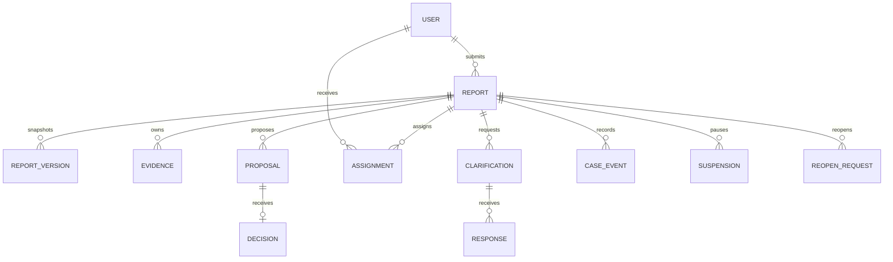

# Spesifikasi Teknis — WBS Universitas Jember

Draf 0.1 • 6 November 2026 • Pendamping `PRD.md`, `flowcharts.md`, dan `design.md`.

Seluruh pilihan implementasi adalah usulan. Dokumen ini belum merupakan kode, kontrak OpenAPI final, atau hasil pengujian keamanan. Gunakan SOP draf sebagai dasar proses.

## 1. Keputusan arsitektur

| Area | Pilihan usulan | Alasan |
|---|---|---|
| Backend | NestJS, TypeScript, modular monolith | Modul terpisah dengan transaksi lintas proses bisnis tanpa microservice awal |
| Frontend | Nuxt, Vue, TypeScript | Satu aplikasi dengan layout publik, pelapor, internal |
| Database | PostgreSQL | Relasi, constraints, transaksi, dan penguncian keputusan |
| Akses data | Prisma ORM 7, Prisma Migrate, adapter PostgreSQL | Revisi implementasi atas permintaan pemilik proyek: CRUD bertipe, transaksi interaktif, dan migrasi berversi; raw SQL terparameterisasi terbatas untuk lock/sequence/worker |
| Redis | Sesi server, rate limit, BullMQ | Tugas asynchronous terpisah dari request |
| Worker | Proses NestJS tersendiri dari codebase sama | Scan, email, pengingat, dan outbox dispatcher |
| Storage | Object storage S3-compatible privat | Bukti tidak disimpan sebagai blob Redis atau folder publik |
| Pemindaian | Scanner malware dengan pemeriksaan jenis berkas | Karantina dan fail closed ketika scan gagal |
| Email | SMTP institusi atau layanan yang disetujui | Verifikasi akun dan pemberitahuan umum |
| Deployment | Docker Compose awal, reverse proxy HTTPS | Operasional sederhana; strategi HA dapat ditambahkan setelah kebutuhan tersedia |

Ini aplikasi satu institusi. Jangan membawa skema multi-tenant dari proyek lain. Versi mayor/minor runtime dan dependency dipilih dari rilis terdukung saat implementasi, lalu dikunci lockfile dan image digest; dokumen ini tidak menetapkan versi terbaru.

Dokumentasi primer: [NestJS queues](https://docs.nestjs.com/techniques/queues), [Nuxt](https://nuxt.com/docs), [PostgreSQL locking](https://www.postgresql.org/docs/current/explicit-locking.html), [PostgreSQL row security](https://www.postgresql.org/docs/current/ddl-rowsecurity.html). Integrasi BullMQ/Redis dan penggunaan row lock diverifikasi dari dokumentasi resmi. Detail aplikasi ini tetap keputusan rancangan.

## 2. Struktur repository

| Jalur | Tanggung jawab |
|---|---|
| `apps/api` | NestJS HTTP API, DTO, guards, application services, repositories |
| `apps/worker` | Bootstrap worker dan job handlers; gunakan application service bersama |
| `apps/web` | Nuxt pages, layouts, components, middleware, composables |
| `packages/contracts` | Tipe hasil OpenAPI dan client API; tidak berisi entity database rahasia |
| `packages/domain` | Aturan transisi dan domain yang dipakai API/worker |
| `database/prisma/schema.prisma` | Model dan relasi Prisma; camelCase dipetakan ke tabel/kolom snake_case |
| `database/prisma/migrations` | Riwayat Prisma Migrate, SQL constraints, partial indexes dan triggers |
| `apps/api/src/seed.ts` | Seed sintetis idempotent menggunakan Prisma Client |
| `docs` | PRD, flowchart, design, OpenAPI, keputusan arsitektur, runbook |
| `deploy` | Compose, proxy, healthcheck, backup dan restore |

Modul backend: Auth, Users, AccessPolicy, Reports, Evidence, Verification, Clarifications, Conflicts, Assignments, Investigations, Approvals, FollowUps, Closures, Suspensions, ReopenRequests, IdentityAccess, Notifications, Audit, PolicyConfig, Health.

Alur dependensi: controller → application service → policy/domain → repository/infrastructure. Controller tidak menjalankan SQL atau keputusan status. Worker memakai application service yang sama dan tetap memeriksa aturan relevan.

## 3. Auth dan policy akses

Gunakan sesi opaque server-side. Browser menyimpan ID sesi acak dalam cookie HttpOnly, Secure, SameSite yang sesuai deployment, path `/`; Redis menyimpan sesi dengan TTL. Simpan hash pengenal sesi bila desain penyimpanan memungkinkan. Rotasi ID setelah login/perubahan hak dan cabut sesi saat keluar, reset sandi, atau penonaktifan.

Sandi memakai password hash adaptif yang dikonfigurasi sesuai kapasitas; token reset/verifikasi berentropi tinggi, di-hash, kedaluwarsa, sekali pakai. Database menyimpan rekam token dan konsumsi atomik; jangan mengandalkan Redis untuk bukti verifikasi permanen. Rate limit berlapis pada login, reset, verifikasi, unggah, dan kirim.

Aplikasi FE dan API berada pada origin sama. Semua mutasi memerlukan validasi CSRF serta origin yang diizinkan; GET tidak memutasi. Middleware Nuxt hanya membantu UX. Backend selalu memeriksa akun aktif, role permission, hubungan perkara, mandat, konflik, izin spesifik, dan versi sebelum tindakan.

Administrator teknis tidak otomatis memperoleh akses isi perkara. Query daftar/detail menggunakan scope akses sejak repository; jangan mengambil semua perkara lalu menyaring di frontend. Pisahkan serializer pelapor, internal tersamarkan, dan identitas berizin menggunakan allowlist kolom.

MFA untuk internal menjadi usulan persyaratan operasional; metode dan recovery ditetapkan sebelum implementasi final. Jika Redis sesi gagal, akses terautentikasi gagal tertutup dan pengguna mendapat pesan layanan sementara tidak tersedia.

## 4. Model data logis

Gunakan primary key internal bigint dan public ID acak untuk URL. Bigint dikirim sebagai string di JSON untuk menghindari batas integer JavaScript. Nomor laporan yang ditampilkan berbeda dari primary key. Foreign key, NOT NULL, CHECK, dan unique constraints melengkapi aturan aplikasi.

| Entitas | Kolom/keterangan utama |
|---|---|
| users | id, public_id, email unik terstandardisasi, password_hash, verified_at, active, auth_version |
| account_tokens | user_id, type, token_hash, expires_at, consumed_at |
| roles / permissions / user_roles | Hak dasar, cakupan, masa berlaku penetapan |
| authority_mandates | user_id, decision_type, scope, valid_from, valid_until, revoked_at |
| reports | id, public_id, owner_user_id, report_number unik nullable saat draf, stage, lifecycle, version, submitted_at |
| report_drafts | report_id unik, payload, version; akses hanya pemilik |
| report_versions | report_id, version_no unik per laporan, snapshot, confidentiality_policy_version, submitted_at; immutable |
| reporter_identities | report_id, encrypted identity/contact fields, key_version; repository dan grant terpisah |
| case_access | report_id, user_id, relation, valid_from/until, revoked_at; mencakup pengelola yang berwenang |
| evidence | report_id, uploader_id, storage_key, original_name, detected_type, bytes, checksum, scan_status, scan_version |
| evidence_links | evidence_id dan parent domain seperti submission_version, clarification, investigation atau follow_up; gunakan tabel relasi dengan FK konkret |
| verifications | report_id, revision, completeness, authority, risk, assessment, author_id |
| conflicts | report_id, user_id, reason, declared_at, resolution, resolved_by |
| clarification_requests | report_id, origin_stage, questions, due_at, status, requester_id |
| clarification_responses | request_id, author_id, content, submitted_at; versi jawaban bila diperlukan |
| proposals | report_id, type, revision, proposer_id, payload, status, expected_report_version |
| approval_decisions | proposal_id, decider_id, decision, reason, mandate_id, decided_at; satu keputusan terminal per revisi |
| assignments | report_id, approved_proposal_id, assignee_id, scope, active_from, revoked_at |
| investigation_entries / findings | report_id, author_id, content, revision, submitted_at |
| follow_up_tasks | report_id, approved_proposal_id, executor_id, required_evidence, due_at, status |
| execution_reviews | task_id, reviewer_id, evidence_assessment, revision, reviewed_at |
| closures | report_id, approved_proposal_id, outcome, reason, official_response_version_id |
| official_response_versions | report_id, version, safe_content, author_id, approved_at |
| suspensions | report_id, origin_stage, reason, owner_id, evaluation_at, resume_conditions, status |
| suspension_evaluations | suspension_id, evaluator_id, result, next_evaluation_at, created_at |
| reopen_requests | report_id, reason, proposed_target_stage, requester_id, proposal_id, status |
| identity_access_requests / grants | report_id, requester_id, reason, authorization, scope, expires_at, revoked_at |
| case_events | report_id, actor_id, action, before/after stage, report_version, reason, visibility, created_at |
| sensitive_access_events | actor_id, report/evidence_id, action, permission_basis, request_id, timestamp |
| policy_versions / work_calendars | Kebijakan, hari libur, SLA, retensi dan masa berlaku |
| idempotency_records | actor_id, operation, key, request_hash, response_reference, expires_at |
| outbox_events / job_receipts | Event bisnis durable, delivery state, unique event_id dan deduplikasi |
| notifications / delivery_attempts | Pesan umum, recipient, state, retry metadata; tanpa isi perkara |

Ini model logis, bukan DDL final. Kurangi duplikasi payload sensitif dalam snapshot, audit, dan outbox. Foreign key owner tidak boleh memakai cascade delete ke perkara; akun dinonaktifkan, penghapusan mengikuti kebijakan retensi.

Constraint minimum: nomor unik; versi laporan unik; satu keputusan terminal per revisi proposal; satu penundaan aktif per perkara; relasi bukti memiliki parent yang valid; transisi menggunakan versi; proposal final tidak diedit. Indeks awal pada owner/tanggal, stage/tanggal, case_access(user_id,report_id), assignments aktif, due_at, scan_status, serta outbox belum diproses. Review dengan query plan dan data sintetis.

### ERD inti

ERD ini hanya relasi inti; tabel akses, mandat, versi, dan audit tetap wajib sesuai tabel di atas.

## 5. Status dan transaksi

Pisahkan `stage` proses dari `lifecycle`: ACTIVE, SUSPENDED, COMPLETED, CLOSED. Draf memakai stage DRAFT; laporan aktif memiliki stage seperti INITIAL_REVIEW atau INVESTIGATION. Klarifikasi adalah request dengan `origin_stage` dan status tersendiri; UI dapat menampilkan “Menunggu klarifikasi” tanpa menghilangkan stage asal. Aturan apakah aksi tertentu diblokir ketika klarifikasi aktif harus dipetakan per command.

Penundaan menyimpan origin_stage dan menolak command proses biasa kecuali evaluasi/pelanjutan atau tindakan lain yang diberi mandat. Persetujuan pembukaan kembali mengaktifkan lifecycle dan menetapkan stage tujuan dalam transaksi, tanpa menghapus closure lama.

Untuk setiap command kritis:

1. Validasi sesi dan input, mulai transaksi database.
2. Lock baris laporan `SELECT ... FOR UPDATE`, lalu proposal/mandat/akses relevan dalam urutan konsisten.
3. Periksa ulang otorisasi dan konflik dari keadaan terkini. Pencabutan akses juga mengikuti lock perkara yang sama agar terurut dengan keputusan.
4. Periksa expected version, tahap, proposal revision, mandat, serta pemisahan pengusul/penyetuju.
5. Simpan keputusan, versi baru, event audit bisnis, dan outbox; commit sekaligus.
6. Setelah commit, dispatcher mengantrekan job berdasarkan event ID. Job idempotent dan retry tidak menjalankan ulang keputusan bisnis.

Batasan idempotensi: scope actor + operation + key; payload berbeda untuk key sama → 409. Duplikat dengan payload sama mengembalikan referensi hasil sebelumnya, tetapi tetap memeriksa hak baca terkini dan tidak memutar ulang respons sensitif setelah akses dicabut. Unique constraint adalah pagar terakhir terhadap race. Deadlock ditangani dengan retry terbatas untuk command yang idempotent.

Redis tidak dipakai sebagai lock utama keputusan. Outbox memungkinkan antrean dibangun ulang ketika Redis gagal/hilang. Email eksternal tidak memiliki jaminan exactly-once absolut; kurangi duplikasi memakai deduplikasi event dan identitas pengiriman bila provider mendukung.

## 6. Bukti, privasi, dan audit

- Storage privat, TLS, enkripsi at rest, akses service terbatas. Simpan bukti asli dan checksum; preview turunan tidak mengganti bukti asli.
- Validasi ukuran, magic bytes/MIME, ekstensi, filename; tolak konten aktif/arsip jika belum ada kebijakan penanganannya. Antivirus bukan jaminan tunggal keamanan.
- Upload diselesaikan dalam dua tahap: objek karantina lalu finalisasi metadata; validasi kepemilikan dan ukuran aktual. Bersihkan objek orphan berdasarkan kebijakan, tanpa menghapus bukti yang sudah diterima.
- Worker memindai, mencatat versi scanner/hasil, dan menandai READY hanya setelah sukses. Timeout/gagal tetap tertutup. Kebijakan rescan dicatat dan akses dapat ditutup saat status scan tidak lagi sah.
- Unduhan melalui API/proxy dengan otorisasi saat request. Untuk bukti sensitif, hindari URL bearer berumur panjang karena pencabutan perkara tidak langsung mencabut URL tersebut. Header unduh aman, nama disanitasi, cache privat `no-store`.
- Identitas terstruktur disimpan terpisah dan terenkripsi dengan kunci di luar database. Berkas dan kronologi juga mungkin mengandung identitas; masking kolom profil saja tidak menjamin anonimisasi. Disposisi memakai ringkasan yang ditelaah; akses bukti mengikuti kebutuhan tugas.
- Pencabutan akses menutup request berikutnya; data yang sudah diunduh atau stream yang sedang berjalan memerlukan kebijakan operasional, tidak dapat dijanjikan ditarik kembali.
- Audit keputusan append-only dengan role aplikasi tanpa update/delete. Hak DBA tetap berisiko; batasi, pantau, dan salin audit ke tujuan terpisah sesuai kebijakan. Jangan menyebut audit kebal manipulasi tanpa kendali infrastruktur yang dibuktikan.
- Pembacaan identitas/bukti mencatat event akses durable sebelum respons sensitif; bila pencatatan wajib gagal, tolak akses. Audit bisnis dan log teknis dipisahkan, tanpa isi kronologi, token, atau kata sandi.
- SSR, cache CDN, analytics, error tracker, dan request logs tidak boleh menyimpan halaman/isi perkara. Gunakan rendering client untuk ruang autentikasi sebagai opsi awal; header `no-store` tetap wajib.

## 7. Rancangan API

Prefix `/api/v1`. Tabel ini katalog awal; tiap endpoint memerlukan policy objek, DTO, dan schema respons sesuai peran. ID berupa public ID; waktu ISO-8601 UTC, UI menampilkan Asia/Jakarta.

| Metode dan jalur | Fungsi |
|---|---|
| POST `/auth/register`, `/auth/login`, `/auth/logout` | Akun dan sesi |
| POST `/auth/email-verifications`, `/auth/email-verifications/consume` | Kirim dan konsumsi verifikasi |
| POST `/auth/password-resets`, `/auth/password-resets/consume` | Pemulihan akun |
| GET `/me` | Profil dan kapabilitas |
| POST `/reports/drafts` | Buat draf |
| GET/PATCH `/reports/:id/draft` | Baca/edit draf pemilik dengan versi |
| POST `/reports/:id/submissions` | Konfirmasi kirim dan snapshot idempotent |
| GET `/reports`, `/reports/:id` | Daftar/detail terfilter akses |
| GET `/reports/:id/timeline` | Event yang boleh dilihat |
| POST `/reports/:id/evidence-uploads` | Mulai upload ke karantina |
| POST `/evidence/:id/finalize` | Validasi upload selesai dan antrekan scan |
| GET `/evidence/:id/download` | Scan + otorisasi + audit akses |
| POST `/reports/:id/verifications` | Catat revisi telaah awal |
| POST `/reports/:id/clarifications` | Permintaan klarifikasi |
| POST `/clarifications/:id/responses` | Jawaban pelapor |
| POST `/reports/:id/conflicts` | Pernyataan konflik dan pencabutan terkait |
| POST `/reports/:id/assignment-proposals` | Usulan penugasan |
| POST `/proposals/:id/decisions` | Persetujuan/pengembalian sesuai jenis dan mandat |
| POST `/reports/:id/investigation-entries` | Jurnal pemeriksaan |
| POST `/reports/:id/findings` | Versi hasil dan rekomendasi |
| POST `/findings/:id/reviews` | Review pengelola |
| POST `/reports/:id/result-proposals` | Usulan hasil dan tindak lanjut |
| POST `/follow-up-tasks/:id/executions` | Pelaksanaan dan referensi bukti |
| POST `/follow-up-tasks/:id/reviews` | Verifikasi bukti pelaksanaan |
| POST `/reports/:id/closure-proposals` | Penutupan normal/dini dan jawaban aman |
| POST `/reports/:id/suspensions` | Penundaan sesuai kewenangan |
| POST `/suspensions/:id/evaluations` | Evaluasi serta keputusan lanjut sesuai mandat |
| POST `/reports/:id/reopen-requests` | Permintaan pembukaan kembali |
| POST `/reopen-requests/:id/proposals` | Proposal tahap tujuan untuk keputusan pejabat |
| POST `/reports/:id/identity-access-requests` | Ajukan akses identitas beralasan |
| POST `/identity-access-requests/:id/decisions` | Putus izin khusus sesuai mandat yang ditetapkan |
| POST `/reports/:id/identity-reveals` | Baca identitas dengan grant dan audit; tidak boleh dicache |
| GET `/reports/:id/audit-events` | Audit terfilter hak |
| GET/PATCH `/policy-configurations/:id` | Konfigurasi terbatas, perubahan membuat versi baru |

API tidak menyediakan PATCH status bebas atau DELETE perkara umum. Command transisi memiliki input spesifik: expectedVersion, alasan, referensi versi proposal/bukti, dan parameter domain. Header Idempotency-Key wajib untuk pengiriman serta keputusan kritis. Respons error memakai code, message aman, fieldErrors bila relevan, requestId; jangan mengembalikan SQL/stack trace.

Gunakan 401 untuk sesi tak sah; 403 untuk aksi yang tidak diizinkan pada objek yang boleh diketahui; 404 untuk objek yang tidak boleh diungkap; 409 untuk konflik versi/transisi/idempotensi; 422 untuk validasi domain; 429 untuk batas percobaan. Daftar memakai pagination dengan batas maksimal dan sort yang diizinkan.

## 8. Nuxt frontend

Layout `public`, `reporter`, `internal` mengikuti design.md. Halaman: beranda, akun/verifikasi, ringkasan, draf/form bertahap, laporan sendiri/detail/klarifikasi, antrean internal, penugasan, pemeriksaan, persetujuan, tindak lanjut, audit, konfigurasi.

Gunakan client API hasil kontrak, composable sesi, middleware navigasi, dan komponen bersama. Kapabilitas yang dikirim backend mengendalikan tampilan aksi; backend tetap mengotorisasi. Tampilkan konflik versi dengan opsi memuat data terbaru, bukan menimpa otomatis. Jangan menyimpan token di localStorage atau isi laporan di analytics. Draf disimpan ke server, bukan persistent browser storage default; data lokal sementara dibersihkan saat keluar.

## 9. Deployment dan operasional

Service awal: reverse-proxy, web, api, worker, postgres, redis, scanner, object-storage bila self-hosted. SMTP dapat eksternal. Hanya proxy diekspos publik; database/Redis/storage/scanner berada pada jaringan privat dan akses admin dibatasi.

API dan worker memakai identitas service dengan privilege minimum; credential migrasi terpisah. Health endpoint publik hanya status umum; readiness memeriksa dependensi kritis tanpa membocorkan konfigurasi. Scanner gagal tidak perlu mematikan seluruh baca laporan, tetapi bukti pending tetap terkunci dan operator mendapat alert.

Backup terenkripsi mencakup PostgreSQL, bukti, versi konfigurasi, serta prosedur pemulihan kunci. Database dan storage harus memiliki titik konsistensi yang didokumentasikan. Uji restore ke lingkungan terisolasi memakai kontrol akses yang sama. Redis dapat dibangun ulang untuk antrean lewat outbox; sesi hilang mengharuskan login ulang.

Urutan rilis: backup → migrasi kompatibel ke depan → deploy API/worker/web → smoke check → pantau. Rollback aplikasi harus cocok dengan schema; migrasi destruktif butuh rencana khusus. Secrets tidak masuk git, bundle frontend, atau log. Retensi dan purge hanya setelah kebijakan disahkan, pengecekan hold, audit, dan verifikasi backup terkait.

## 10. Verifikasi implementasi

Unit: aturan status, mandate/self-approval, kalkulasi hari kerja, masking serializer. Integrasi PostgreSQL/Redis: constraint, transaksi rollback, submit ganda, keputusan bersamaan, konflik/pencabutan, pemulihan outbox. Integrasi scanner/storage: berkas lolos, berkas uji malware yang aman untuk pengujian, scanner gagal, upload orphan, dan akses langsung ditolak.

E2E/UAT: seluruh skenario PRD pada peran berbeda, desktop dan mobile. Lakukan pemeriksaan authorization objek, CSRF, session rotation, cache sensitif, unduhan dan data di log. Uji backup/restore dan beban sesuai target PRD. Rancangan ini tidak berarti pengujian tersebut telah dijalankan.

## 11. Definisi selesai per fitur

Fitur memiliki aturan domain dan policy akses, migrasi terversi, API terdokumentasi, UI semua state utama, audit, skenario penerimaan, serta runbook jika ada job/operasional. Dokumentasi harus menyebut kebijakan yang masih belum disahkan. Jangan menandai seluruh WBS siap produksi hanya karena alur utama berhasil.
